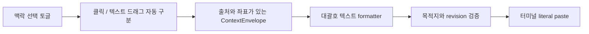

# PRD1 화면 맥락 전달 설계

> 한 줄 요약: 내부 웹의 클릭과 텍스트 드래그를 자동 구분해 출처·위치·내용을 이미지 없이 대괄호 텍스트로 전달한다. 대상: 사람(설계 검토).

## 1. 범위와 근거

- 요구 원본: 2026-10-29 대화의 PRD1. 보고 있는 웹/HTML/파일의 위치와 내용을 클릭·드래그로 선택하고, 토글을 통해 터미널에 바로 전달하며 `[내용]`으로 표시한다. 별도 PRD 파일은 아직 없다.
- 관련 결정: [ADR-0001](../decisions/0001-browser-context-handoff.md). 제안 브랜치: `codex/browser-context`.
- 2026-10-29 후속 결정: 내부 브라우저·localhost·HTML을 1차 범위로 채택했다. 클릭/드래그 자동 구분과 실제 대괄호 텍스트 표시를 채택했고, 이미지 전달은 당장 제외한다. 사용자가 요소/텍스트/영역 모드를 따로 고르는 이전 제안은 폐기한다.
- 2026-10-29 설명 후 사용자 동의로 전달 흐름을 확정했다. 같은 workspace에서 방금 대화하던 에이전트 터미널에 자동 연결해 맥락을 입력칸에 삽입하고, 사용자가 요청을 덧붙여 Enter로 제출한다. 매번 목적지를 고르거나 맥락 선택만으로 자동 제출하지 않는다.
- 관찰 기준: 2026-10-29, HEAD `ef3d1307e116d1c0ba3c6f5ea124a6d28f6c01fe`와 작업 트리. 다른 작업의 개발 환경 격리 변경이 있어 전체 작업 트리는 고정된 릴리스가 아니다.
- 확정한 1차 범위: cmux 내장 브라우저, localhost 웹, 브라우저에서 정상적으로 열린 HTML. 텍스트/Markdown/PDF 전용 뷰어는 이번 버전 밖이며 후속 범위다.
- 1차 제외: 외부 Chrome/Safari/다른 macOS 앱 수집, 사각형 영역 선택, 이미지·스크린샷·OCR·파일 첨부 전달, 임의 파일 파서, 웹 좌표만으로 소스 파일·행 번호 추정, 자동 프롬프트 제출.

### 현재 구현과 필요한 변화

| 확인한 현재 코드 | 설계에서 재사용할 부분 | 아직 필요한 부분 |
|---|---|---|
| [BrowserPanel+ElementPicker](../../../Sources/Panels/BrowserPanel+ElementPicker.swift) | Design Mode 활성화와 React Grab 상호 배제 | 맥락 선택 토글의 상태와 목적지 표시 |
| [BrowserDesignModeController](../../../Sources/Panels/BrowserDesignModeController.swift) | 요소 정보와 snapshot revision | 텍스트 드래그와 클릭 자동 구분, 이미지 경로를 호출하지 않는 수집 |
| [기존 handoff](../../../Sources/Panels/BrowserDesignModeController+Handoff.swift) | 비동기 작업 revision 확인 패턴 | artifact가 필요 없는 텍스트 전용 전달 경로 |
| [AppDelegate](../../../Sources/AppDelegate.swift)의 `handleReactGrabDidCopySelection` | workspace와 반환 터미널을 식별하는 전달 경로 | 목적지 고정, 실패/중복 처리 계약 |
| [CmuxBrowser DesignMode](../../../Packages/macOS/CmuxBrowser/Sources/CmuxBrowser/DesignMode) | formatter, viewport, URL 정제 | 텍스트 전용 context envelope |

기존 코드가 존재함을 확인했으며 이 작업에서 실제 UI 동작은 실행하지 않았다. Design Mode의 현재 handoff는 클립보드 중심이므로, 이것만으로 직접 삽입 요구가 충족됐다고 판단하지 않는다.

## 2. 논리 구조



| 책임 | 소유 경로 제안 | 입력 → 출력 |
|---|---|---|
| 토글·목적지·상태 표시 | `Sources/Panels/` | 사용자 선택 → 명시적인 수집 세션 |
| 수집과 정규화 | `CmuxBrowser/DesignMode` 및 뷰어별 어댑터 | DOM/선택 범위 → ContextEnvelope |
| 전달 조정 | `Sources/`의 전용 coordinator, AppDelegate는 연결만 담당 | envelope + 목적지 → DeliveryResult |
| 터미널 입력 | 기존 provider-aware paste 경로 | 문자 그대로 붙여넣기, submit 없음 |

제안 타입과 메서드는 아직 구현된 공개 API가 아니다. 최초 버전은 앱 내부 연결로 한정하며 새 원격 socket API를 만들지 않는다.

### 데이터 계약 제안

`ContextEnvelope v1`은 `captureID`, `capturedAt`, `source`, `selection`, `target`을 가진다. capture는 텍스트·요소 snapshot을 뜻하며 이미지 캡처가 아니다. 1차 버전에는 artifacts 필드를 두지 않는다.

- `source`: 뷰어 종류, source panel ID, 문서 revision/navigation generation, 정제된 URL 또는 로컬 파일 경로, 파일일 때 실제로 확인된 페이지/행 범위.
- `selection`: `element | text`, 선택 텍스트, 제공되는 경우 DOM selector/접근성 이름, 좌표와 좌표계. 클릭한 이미지 요소도 대체 텍스트/요소 정보만 수집하며 이미지 픽셀은 전달하지 않는다.
- 웹 좌표는 캡처 시점 viewport 기준 CSS px이며 `x/y/width/height`, viewport 크기, scroll offset을 함께 기록한다. zoom/DPR/visual viewport 정보는 실제 수집 가능 여부를 확인하고 필요 시 추가한다. AppKit point나 PNG pixel을 CSS px로 가장하지 않는다.
- `target`: 선택 시작 시 고정한 workspace ID와 terminal panel ID. 창 이동 후에는 동일 panel의 현재 소유자를 재해석한다.
- 출처·선택 내용은 모두 텍스트 본문에 포함한다. 로컬 캡처 파일 생성, 이미지 업로드, 첨부 lease와 보존 기간은 1차 기능에 필요하지 않다.

터미널 표시 예시:

```text
[웹 맥락 | http://localhost:3000/settings
선택: 저장 버튼
위치: viewport CSS px (820, 460, 90, 32)
요소: button[data-testid="save"]]
```

위 예시는 설명용 값이다. 일반 터미널에서는 실제 텍스트이며, 접었다 펼치는 attachment chip으로 주장하지 않는다. 경로나 소스 행은 확인되지 않으면 생략하고, URL은 기존 정제 규칙을 유지한다.

## 3. 데이터·요청 흐름

1. 같은 workspace에서 방금 에이전트와 대화하던 터미널에 자동 연결한다. 매 선택마다 목적지를 묻지 않는다. 작은 대상 표시와 변경 방법, 후보가 없거나 모호할 때의 선택 UI는 세부 구현 제안이다. 개발 서버 터미널을 단순히 가장 최근 포커스였다는 이유로 대신 선택하지 않는다.
2. 토글 ON에서 클릭은 요소, 실제 텍스트 selection을 남긴 드래그는 그 문장으로 자동 구분한다. pointer 이동과 browser selection을 함께 보고 mouse-up 시 한 번 판정한다. drag 시작 때 click 전송을 먼저 하지 않는다. 버튼·링크의 원래 실행은 선택 중 차단하되 텍스트 드래그는 유지한다.
3. 비텍스트 빈 공간 드래그나 선택이 생기지 않은 drag는 맥락을 보내지 않는다. 사각형 영역 선택과 이미지 전송으로 자동 전환하지 않는다. OFF에서는 원래 페이지 조작이 돌아온다.
4. 선택 완료 시 revision과 좌표를 함께 수집한다. 전후 revision/navigation이 다르면 이전 결과를 버리고 재선택 상태로 돌아간다.
5. 맥락 텍스트를 agent 입력창에 넣고 사용자가 ‘이 버튼을 옮겨줘’ 같은 요청을 덧붙인 뒤 제출한다. literal paste만 수행하며 Enter/제출 키는 보내지 않는다. 사용자가 설명 후 채택한 흐름이다.
6. `captureID + target`으로 한 선택의 중복 전달을 억제한다. 입력 결과가 불명확하면 자동 재전송하지 않고 확인 가능한 상태로 남긴다. PTY write 성공이 에이전트의 맥락 수신/이해를 증명하지는 않는다.
7. 목적지가 닫히면 다른 터미널로 임의 전송하지 않는다. 실패한 선택은 현재 브라우저에서 다시 보낼 수 있다. 다른 workspace로 이동한 목적지는 표시를 갱신하고 재선택을 요구한다.

상태: `off → armed → collecting → delivering → armed`; 실패는 선택과 목적지를 보존하는 `error`로 전환한다. 토글 OFF/문서 변경/뷰어 종료는 미전달 작업만 취소한다. 이 경로는 이미지 artifact를 생성하지 않는다.

SSH/원격 에이전트에도 전송 내용은 텍스트다. 본문에 등장하는 로컬 HTML 경로가 원격에서 접근 가능하다고 주장하지 않는다. 관계형 DB·ERD는 해당 없음: 일시적인 맥락만 사용한다.

## 4. 실행·배포 환경 (AWS 사용 또는 비교 요청 시 AWS 뷰 포함)

- 목표 환경: 로컬 macOS cmux 앱. Swift/AppKit/WebKit와 기존 Ghostty 입력 경로를 사용한다. 신규 서버·클라우드 배포는 없다.
- 개발 환경은 [포크 개발 가이드](../../jmin-development.md)를 따른다. 해당 가이드는 관찰 시 미커밋 작업이므로 완료·검증 상태는 별도로 확인한다.
- 현재 wrapper는 `jmin` 태그를 고정한다. 브랜치 네 개를 동시에 실행할 때 사용할 고유 bundle/socket/config 분리는 추가 준비사항이다. 같은 태그 빌드를 동시 실행하지 않는다.
- 설치 앱 교체, 설정 자동 복사, 클라우드 계정 변경은 범위 밖이다. 기능 OFF 시 기존 선택과 복사 동작으로 돌아가도록 한다.
- 운영 주체는 로컬 사용자. 출시일·성능 목표·지원 종료일은 미정. 장애 진단은 §5, 검증은 §6을 기준으로 하며 별도 운영 문서는 아직 없다.

## 5. 보안·관측·운영

| 주체 | 허용하는 동작 | 경계 |
|---|---|---|
| 사용자가 활성화한 picker | 현재 뷰어에서 선택한 부분 수집 | 숨겨진 입력·쿠키·페이지 전체 상태의 포괄 수집 제외 |
| 페이지 JS 메시지 | 검증된 선택 payload 제공 | 임의 terminal ID/파일 경로/명령 실행 권한 없음 |
| 전달 coordinator | 고정된 앱 소유 터미널에 literal paste | 제어문자/escape sequence 제거, bracketed-paste 계약 확인 |

일반 shell/TUI가 paste를 어떻게 해석하는지는 다르므로, ‘submit 키를 보내지 않음’만으로 임의 터미널의 실행 방지를 보장하지 않는다. 지원 입력 경로를 확인하고, 안전한 literal paste를 보장하지 못하는 대상은 입력 초안/복사 fallback을 제공한다.

페이지 내용은 인용 데이터로 표시한다. 크기 제한은 구현 전 기존 입력 한도를 확인해 정하고, 초과는 조용히 잘라내지 않고 표시한다. 진단에는 capture ID, 결과 코드, 길이, 단계만 남기며 선택 본문·전체 URL·파일 내용은 기본 로그에서 제외한다. 예상 오류는 대상 없음, 오래된 선택, 지원하지 않는 프레임/뷰어, 입력 실패로 구분한다.

## 6. 검증 계획과 미확인

| 검증 | 통과 조건 | 실패 신호 |
|---|---|---|
| 클릭/텍스트 drag fixture | 모드 선택 없이 요소 또는 문장 한 번 전달 | drag 시작에 요소를 먼저 전송, 중복 입력 |
| 빈 공간 drag/이미지 요소 클릭 | 이미지 파일·픽셀을 만들거나 보내지 않음 | 영역 모드·이미지 캡처 자동 활성화 |
| scroll/zoom/캡처 중 navigation | 같은 revision만 전달 | 이전 페이지 내용이 새 URL로 전송 |
| 터미널 둘 + 포커스 전환 | 표시한 대상에 한 번 삽입 | 다른 터미널 입력, 중복 입력 |
| shell/지원 agent 입력 | 자동 제출 없음, literal 처리 | 제어문자 실행 또는 프롬프트 즉시 실행 |
| OFF/Escape/대상 종료 | 페이지 조작 복귀, 미전달 작업 취소 | 클릭 가로채기 잔류, 다른 대상 fallback |
| iframe/HTML/원격 대상 | 실제 수집한 텍스트와 제한을 표시 | 읽지 못한 맥락·파일을 접근 가능하다고 표시 |

현재 확인은 코드와 문서 읽기 및 이 설계 문서의 정적 검사다. 기능 테스트·앱 빌드·GUI 검증은 미실행이다. 제품 문자열 구현 시 저장소 localization 규약을 적용한다.

남은 세부 설계·검증: 대상 표시/변경 UI, 대상 후보가 없거나 모호할 때의 처리, 텍스트 길이 상한, 클릭/drag 판정 threshold와 브라우저별 동작. 1차 범위·자동 구분·대괄호 텍스트·이미지 제외·대화하던 에이전트 자동 연결·삽입 후 수동 제출은 확정했으며 다시 선택을 요구하지 않는다.

## 관련

- [ADR-0001](../decisions/0001-browser-context-handoff.md)
- [기능 문서 색인](../INDEX.md)
- [기여·개발 안내](../../../CONTRIBUTING.md)
