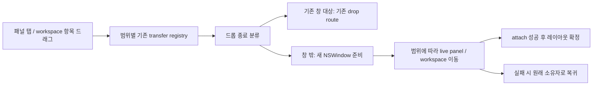

# PRD2 창 밖 드래그 분리 설계

> 한 줄 요약: 개별 패널과 workspace 전체를 모두 창 밖 드롭으로 분리하고, 기존 레이아웃·실행 세션·빈 workspace 정책을 유지한다. 대상: 사람(설계 검토).

## 1. 범위와 근거

- 요구 원본: 2026-10-29 대화의 PRD2. cmux 내부의 창을 앱 밖으로 드래그·드롭하면 새 cmux 창을 만든다. 별도 PRD 파일은 아직 없다.
- 관련: [ADR-0002](../decisions/0002-live-panel-window-transfer.md). 제안 브랜치: `codex/drag-out-window`.
- 2026-10-29 후속 결정: 개별 패널뿐 아니라 workspace 전체 분리도 1차에 포함한다. 마지막 패널 이동 뒤의 원래 창은 기존 빈 workspace 정책을 유지한다. 두 항목은 사용자 확정이다.
- 개별 대상은 cmux의 터미널·브라우저·파일 미리보기 패널이며 외부 앱 창은 범위 밖이다. workspace 전체 이동은 내부의 분할 구조·탭 순서·선택·세션을 함께 보존한다.
- 관찰 기준: 2026-10-29 HEAD `ef3d1307e116d1c0ba3c6f5ea124a6d28f6c01fe`와 다른 미커밋 변경이 포함된 작업 트리. 실제 드래그 동작을 실행하지 않았다.
- 재사용 근거: [AppDelegate](../../../Sources/AppDelegate.swift)의 `moveSurface`, `moveWorkspaceToNewWindow`, [ExternalTabDrop](../../../Sources/Workspace+ExternalTabDrop.swift), [PaneTransferDropRouter](../../../Sources/PaneTransferDropRouter.swift), [PaneTransferSourceResolver](../../../Sources/PaneTransferSourceResolver.swift).
- [sidebar drag 종료 처리](../../../Sources/Sidebar/AppKitList/SidebarWorkspaceTableController.swift)도 존재한다. 따라서 새 창 전환 기능 전체가 없다고 판단하지 않고, 창 밖 드롭의 연결과 패널 종류별 지원을 확인한다.
- 비목표: 새로운 cmux 앱 프로세스 실행, 터미널 명령 재실행, OS 간 창 이동, 다른 프로세스의 cmux 인스턴스에 live panel 이전.

## 2. 논리 구조

| 구성요소 | 책임 | 소유 경로 제안 |
|---|---|---|
| 드래그 source | panel/workspace 종류와 유효한 transfer capability 발급 | 패널 탭/헤더와 sidebar workspace drag source |
| DropCompletionClassifier | 내부 수락/외부 release/취소/불명 상태 구분 | `Sources/` 새 helper |
| WindowTransferCoordinator | 새 창 생성, 이동 실행, 완료·실패 조정 | `Sources/` 새 helper; AppDelegate의 기존 서비스 호출 |
| 기존 transfer/move 구현 | 실제 live panel detach/attach와 소유권 이전 | `AppDelegate`, workspace transfer 경로 |
| 창 배치 정책 | screen point를 표시 가능한 새 창 위치로 변환 | 기존 window placement 경로 |

새 helper 이름은 설계 제안이다. 기존 pane transfer registry를 우회하는 두 번째 소유권 체계를 만들지 않는다. UI entrypoint는 달라도 최종 이동 동작은 하나로 모은다.

### 이동 데이터 계약 제안

`WindowTransferIntent`: `dragSessionID`, `transferToken`, `scope: panel | workspace`, 해당 범위의 `panelID` 또는 `workspaceID`, `sourceWindowID`, 원래 위치, `endScreenPoint`, `completionKind`. panel scope에는 원래 workspace/pane/index, workspace scope에는 원래 window/index와 layout identity를 기록한다.

- `transferToken`은 프로세스 내부 registry가 검증한 현재 드래그의 capability이다. pasteboard에서 읽은 UUID만으로 객체를 이동하지 않는다.
- `endScreenPoint`는 AppKit screen 좌표다. Retina 배율, 다중 모니터와 음수 좌표를 보존하고 CSS 좌표와 섞지 않는다.
- `TransferOutcome`: `moved(existing/newWindowID) | cancelled | unsupported | failed(restored)`.
- panel scope에서는 panel/session identity를 유지하며 소속 workspace/window만 변경한다. workspace scope에서는 workspace ID와 자식 panel 전체를 유지하며 window 소유자만 변경한다.

## 3. 데이터·요청 흐름

### 드롭 종료 판정

1. 패널 분리는 해당 탭/헤더, workspace 전체 분리는 sidebar workspace 항목에서 시작하는 안을 제안한다. payload scope로 이동 단위를 고정한다. 터미널 텍스트 선택, 파일 드롭, URL 드래그는 별도 타입으로 남긴다.
2. 기존 창의 drop target이 수락하면 해당 경로가 우선하고 새 창을 만들지 않는다.
3. 수락되지 않았고 사용자가 실제 mouse-up으로 모든 같은 인스턴스의 cmux 창 밖에 놓은 경우만 새 창 후보로 삼는다. `NSDragOperation.none`만 보고 외부 드롭으로 판단하지 않는다. Escape·취소·source 제거도 같은 값으로 끝날 수 있다.
4. 종료 사유를 확실히 구분할 수 없으면 원래 위치를 유지한다. 외부 화면 영역을 지나가는 것만으로 창을 만들지 않는다.
5. 타 앱 위에 놓는 경우는 cmux 패널을 그 앱에 전달하지 않고, 외부 mouse-up으로 확인된 경우 새 cmux 창을 만든다는 제안이다. Dock/Mission Control 등 특수 대상은 실제 AppKit 동작 검증 후 지원 범위를 명시한다.

### 소유권 이전과 복구

1. registry가 intent를 검증하고 source의 소유자·원래 위치를 기록한다. 완료된 dragSessionID는 재처리하지 않는다.
2. source를 유지한 채 대상 NSWindow/workspace를 준비한다. 준비 실패 시 source를 그대로 둔다.
3. panel scope는 기존 `moveSurface`, workspace scope는 기존 `moveWorkspaceToNewWindow`/workspace 이동 경로를 사용한다. workspace 전체를 panel별 이동의 반복으로 구현하지 않는다. 두 경로의 실패 복구를 검증하고, coordinator와 기존 경로가 창을 이중 생성하지 않게 생성 책임을 한쪽에 둔다.
4. attach가 끝난 후에만 bootstrap 패널/빈 workspace 정리와 focus 이동을 확정한다. source의 마지막 패널 처리에는 기존 빈 workspace 정책을 적용한다. 별도 제품 정책으로 창을 자동 종료하지 않는다.
5. 실패하면 원래 pane/index와 focus로 돌려놓고 빈 대상 창을 제거한다. source 창이 동시에 닫히는 등의 복구 불능 상황에서는 마지막 유효 owner를 유지하고 오류를 표시한다. 살아 있는 세션을 임의 종료하지 않는다.
6. 세션 저장은 이동 완료 뒤 일관된 layout을 기록한다. 중간 detach 상태를 정상적인 빈 레이아웃으로 저장하지 않도록 기존 저장 경로를 검증한다.

이 경계는 데이터베이스 트랜잭션이 아니라 main-actor UI/소유권 변경과 실패 보상이다. ERD는 해당 없음. drag 취소와 앱 충돌 후 복원을 같은 보장으로 취급하지 않는다.

### 패널 지원 정책

- 터미널: PTY/session·스크롤백·입력 상태를 보존한다. remote terminal은 기존 연결을 옮기며 remote process를 다시 시작하지 않는다.
- 브라우저: 기존 WKWebView와 navigation/form state를 유지한다. URL을 새 webview에서 다시 여는 방식은 요구를 충족하지 못한다.
- 파일 미리보기 및 기타 provider: 기존 transfer capability가 있으면 이동한다. capability가 없으면 unsupported로 표시하며 파괴적인 재생성을 하지 않는다.
- PRD3의 그룹 surface가 구현되면 그룹 뷰 이동과 실제 세션 소유자의 범위를 해당 feature 계약으로 정의한다. PRD2는 PRD3를 기다리지 않고 기존 panel로 검증한다.

## 4. 실행·배포 환경 (AWS 사용 또는 비교 요청 시 AWS 뷰 포함)

- 단일 macOS cmux 앱 프로세스의 여러 NSWindow에 적용한다. 신규 서버, DB, AWS 자원은 해당 없음.
- [포크 개발 가이드](../../jmin-development.md)의 별도 개발 앱에서 확인한다. 현재 `jmin` 고정 태그는 여러 feature build를 동시에 구분하지 못하므로 동시 실행에는 별도 태그 분리 준비가 필요하다.
- 터미널 종료나 설치 앱 교체 없이 실험한다. 테스트용 개발 창/프로세스만 사용한다.
- 배포 상태: 설계 초안. 구현 시 기능 설정으로 외부 drop gesture를 켜고 끌 수 있게 하는 것을 제안한다. OFF에서는 기존 내부 drag/drop이 유지되어야 한다.
- 운영 주체는 로컬 사용자. 출시·지원 종료·성능 수치는 미정이며, 실패 진단과 검증은 §5·§6을 따른다.

## 5. 보안·관측·운영

등록된 같은 프로세스의 transfer capability만 소비한다. 다른 앱이 만든 유사 pasteboard payload나 만료된 drag token은 무시한다. 새 창 이동은 에이전트 실행 권한을 바꾸지 않는다.

진단 이벤트는 drag ID, panel kind, phase, source/destination의 축약 ID, 결과 코드로 한정한다. 터미널 본문·웹 주소·파일 내용은 필요 없다. 같은 drag에서 새 창이 두 개 생기거나 panel이 두 owner에 속하는 경우는 불변식 위반으로 기록한다.

키보드/접근성 대안으로 기존 ‘새 창으로 이동’ 명령을 같은 이동 경로에 연결한다. 기존 다른 진입점의 동작을 유지하는지 검증한다.

## 6. 검증 계획과 미확인

| 검증 | 통과 조건 | 실패 신호 |
|---|---|---|
| 분류기 단위 검증 | 내부 수락, 외부 release, Escape, source 소멸을 구분 | 취소했는데 새 창 생성 |
| transfer 실패 주입 | 준비/attach 실패 후 source 상태 보존 | 잃어버린 panel, 중복 owner |
| 실행 중 터미널 이동 | 동일 프로세스·세션, 스크롤백 유지 | 재실행, 입력 소실, disconnect |
| 여러 패널이 있는 workspace 전체 이동 | workspace identity, 분할 비율·탭 순서·선택·모든 세션 유지 | 일부 패널만 이동, 새 세션 생성 |
| 브라우저 폼/히스토리 이동 | 동일 페이지 상태 유지 | reload 또는 로그인 상태 소실 |
| 마지막 패널·여러 모니터 | 유효한 빈 상태, 보이는 위치에 새 창 | 기존 앱 종료, 화면 밖 생성 |
| 반복 종료 콜백 | 한 drag당 최대 한 번 이동 | 창 중복 생성 |
| 다른 창·Dock·fullscreen | 기존 drop 우선, 지원 범위 명시 | 수락한 이동과 외부 분리가 중복 |

현재는 소스와 문서 읽기만 수행했다. native drag, 앱 빌드, 세션 지속성 검증은 미실행이다. UI 문자열은 구현 시 localization 대상이다.

미결: provider별 transfer capability, workspace/개별 panel의 drag handle 세부 UX, 특수 화면 대상 지원. workspace 전체 포함과 기존 빈 workspace 정책 유지는 확정했으며 구현 검증 대상이다.

## 관련

- [ADR-0002](../decisions/0002-live-panel-window-transfer.md)
- [기능 문서 색인](../INDEX.md)
- [기여·개발 안내](../../../CONTRIBUTING.md)
