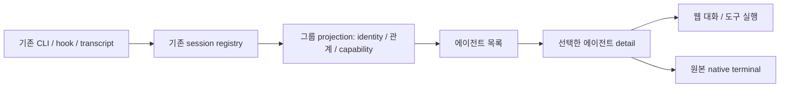

# PRD3 에이전트 작업 화면 설계

> 한 줄 요약: 부모·팀원·서브에이전트를 한 작업 화면에 묶고 대화·도구 실행·원본 터미널을 선택해 보되 실제 실행 세션은 독립적으로 유지한다. 대상: 사람(설계 검토).

## 1. 범위와 근거

- 요구 원본: 2026-10-29 대화의 PRD3. 서브에이전트·Claude Teams가 보이고, 웹 대화 UI로 정돈하되 터미널 뒷단을 숨기지 않으며, 한 workspace에서 대화를 시작할 때 창이 계속 늘어나지 않게 관리한다.
- 관련: [ADR-0003](../decisions/0003-agent-group-view-and-session-ownership.md). 제안 브랜치: `codex/agent-workspace`.
- 2026-10-29 사용 장면 설명 후 사용자 동의로 ‘메인 대화를 유지하고 같은 surface 안에서 하위 작업 상세를 펼치는 방식’을 채택했다. ‘surface 하나’는 작업 그룹의 최상위 진입점 하나이며 실제 에이전트 프로세스/PTY의 identity와 수명은 각각 유지한다.
- Brain 웹은 참조하려는 제품이라는 사실만 알고 있으며 실제 파일·화면은 확인하지 않았다. 그 UI와 동일한 설계라고 주장하지 않는다.
- 관찰 기준: 2026-10-29 HEAD `ef3d1307e116d1c0ba3c6f5ea124a6d28f6c01fe`와 다른 미커밋 변경이 있는 작업 트리. 실행·GUI 검증은 하지 않았다.
- 1차 제안: 한 workspace에 속한 로컬 Claude/Codex 세션과 식별 가능한 child/team 관계. 팀원/child의 지원 수준은 실제 provider의 이벤트·transcript·terminal binding에 따라 구분한다. 그 외 provider와 원격 세션은 미지원 또는 읽기 범위를 명시한다.
- 비목표: 독자 agent loop·새 오케스트레이터, 다른 에이전트를 자동 생성하는 기능, 관찰할 수 없는 대화/내부 추론 복원, 하나의 터미널에 여러 agent 출력 혼합.

### 2026-10-29 니즈 구체화 — 사용자 채택

추상적인 구조 설명 대신 실제 작업 장면과 화면 구성을 제시했고, 사용자는 이에 동의했다. 아래 사용 흐름은 확정 요구로 기록한다. 세부 컴포넌트/API와 native host 구현은 검증할 설계안이다.

채택한 니즈: **한 작업 대화를 시작하면 그 안에서 생긴 에이전트들의 일을 따라볼 수 있고, 사용자가 창을 계속 정리할 필요는 없어야 한다.** 메인 에이전트와의 대화를 기준으로 맥락을 유지하면서 누가 무엇을 하는지, 어느 작업이 입력을 기다리는지, 실제 어떤 명령과 도구가 실행됐는지 확인한다.

예시 장면: ‘로그인 화면 수정’을 메인 에이전트에 요청한다. 메인이 조사·구현·검증을 나누면 한 화면 안에 작은 작업 목록이 생긴다. 각 행은 이름/역할, 현재 작업, 실제 관찰한 상태를 보여준다. 새 창이나 최상위 탭이 자동으로 늘어나지 않는다.

```text
workspace: 로그인 화면 수정
┌ 작업 대화 ───────────────────────────┐
│ 메인과 나눈 대화 / 계속 쓰는 입력창     │
│                                      │
│ 함께 진행 중인 작업                   │
│  조사     로그인 흐름 확인     완료   │
│  구현     로그인 폼 수정       진행   │
│  검증     테스트 준비          대기   │
│                                      │
│ 펼친 항목: 구현                       │
│ [대화] [도구·실행 기록] [원본 터미널]  │
│ 해당 에이전트의 실제 관찰 가능한 내용 │
└──────────────────────────────────────┘
```

위 이름·상태는 시나리오 예시이며 실제 provider가 제공하지 않는 항목을 만들어 표시하지 않는다. 채택한 사용자 경험은 다음과 같다.

- 기본은 메인 대화를 유지하고 하위 작업 상세를 같은 surface 안에서 펼친다. 한 번에 하나의 상세만 펼쳐 혼잡을 줄인다. 내부의 목록과 상세를 여러 개의 독립 cmux surface로 만들지 않는다.
- 웹 UI에서도 도구 사용·실행 명령·결과 등 실제 제공되는 기록에 접근할 수 있다. 예쁜 완료 문장만 보여주고 원본 실행을 확인할 길을 없애지 않는다. 원본 터미널이 있으면 같은 그룹에서 전환해 본다.
- 입력 필요/실패는 해당 항목에서 눈에 띄게 표시한다. 다른 에이전트의 진행 이벤트가 사용자가 읽는 대화를 강제로 바꾸지 않는다.
- 계속 지켜보고 싶은 항목만 사용자가 직접 별도 panel로 꺼낸다. 접기·펼치기·보기 변경은 실행을 멈추거나 새 agent를 시작하지 않는다.
- 하위 에이전트에게 직접 메시지를 보내는 새 기능은 원래 요구의 필수 조건이 아니다. 1차 입력은 메인 대화가 기준이며, 기존 지원 상호작용은 원본 터미널로 접근할 수 있다. 별도 멤버 입력창은 필요가 확인될 때 capability가 있는 대상에만 추가한다.

메인 대화를 유지하고 상세를 펼치는 안을 채택했다. 멤버 선택으로 메인 본문 전체를 대체하는 방식을 기본으로 삼지 않는다. 상세를 아래/옆 어느 위치에 배치할지와 좁은 창의 반응형 처리는 세부 디자인 사항이다. 위 그림은 동작 설명이며 최종 픽셀 목업은 아니다. Brain 화면의 정확한 재현은 이번 동의로 확인된 것이 아니다.

### 현재 코드가 제공하는 것

| 근거 | 확인한 기능 | 이번 설계에서 남은 일 |
|---|---|---|
| [agent-chat README](../../../agent-chat/README.md) | 로컬 sidecar와 터미널 transcript 기반 채팅 경로 | 여러 세션을 한 그룹의 선택 뷰로 묶기 |
| [Workspace+AgentChat](../../../Sources/Workspace+AgentChat.swift) | 기존 terminal을 새 browser split으로 표시 | 선택마다 split을 만들지 않는 그룹 host |
| [SessionRegistry](../../../Sources/Mobile/AgentChat/AgentChatSessionRegistry.swift) | terminal-bound 세션 관찰 | 그룹의 안정적인 identity와 capability 투영 |
| [ChildRuns](../../../Sources/Mobile/AgentChat/AgentChatSessionRegistry+ChildRuns.swift) | 부모 이벤트로 child 시작/종료 추적 | 독립 세션·transcript와 실제 연결되는지 검증 |
| [CustomSidebarSnapshot](../../../Sources/Workspace+CustomSidebarSnapshot.swift) | workspace별 agent 목록 | 같은 데이터를 사용하는 그룹 탐색 UI |
| [CLI 계약](../../../docs/cli-contract.md) | `claude-teams` / `codex-teams` 진입점 | 자동 pane 생성 위치와 그룹 수용 경로 검증 |

[기존 subagent 계획](../../../docs/subagents-panel-plan.md)의 ‘child record가 없다’는 설명은 현재 `ChildRuns` 코드와 다르다. 코드에 child bookkeeping은 있지만, 모든 child가 독립 terminal/transcript를 가진다고 결론내릴 수는 없다. 일부 종료는 ID 없는 FIFO 대응이며 확정 완료와 구분해야 한다. `agent-chat/types.ts`의 parent metadata도 대화 fork와 subagent 관계를 구분해 해석한다.

## 2. 논리 구조



| 구성요소 제안 | 책임·소유 경로 | 원칙 |
|---|---|---|
| AgentGroupProjection | `Sources/`에서 registry의 읽기 모델 생성 | 관찰 데이터를 투영하며 실행 상태를 새로 발명하지 않음 |
| AgentGroupHost | `Sources/Panels/`의 native container | 한 최상위 진입점, 선택한 detail만 표시 |
| GroupRoster / ConversationDetail | `agent-chat/src/` 기존 웹 UI 확장 | 목록·대화·도구 표시와 native 선택 요청 |
| SessionViewResolver | 기존 workspace/surface 서비스와 연결 | 동일 세션의 기존 terminal renderer를 선택해 보여줌 |
| provider adapters | 기존 `agent-chat/adapters/`와 native registry 연결 | 버전·capability·누락 정보를 명시 |

웹 UI는 목록과 대화 표시를 담당하고 실제 Ghostty terminal은 native host가 담당한다. webview 안에 native terminal이 저절로 들어간다고 가정하지 않는다. 기존 terminal panel은 소유 registry에 유지하고, 그룹 내부 표시/외부 panel 표시를 구분하는 layout projection을 추가하는 방향을 제안한다. 동일 terminal view를 동시에 두 host에 mount하지 않는다.

그룹 통합 가능성을 먼저 spike로 확인해야 한다. 현재 `newBrowserSplit`만 재사용하면 ‘최상위 surface 하나’ 요구가 충족되지 않는다. 기존 terminal의 background 수명·focus·resize를 보존하는 group host가 불가능하면 그 한계를 드러내고 ADR을 재검토한다.

### 데이터 계약 제안

| 모델 | 필드·불변식 |
|---|---|
| Group | `groupID`, `workspaceID`, `rootSessionKey?`, `selectedMemberID?`, `detailMode`, `revision` |
| Member | `memberID`, `kind: root/team/child`, `sessionKey?`, `parentMemberID?`, `relationKind`, `relationshipEvidence`, `startedAt?` |
| SessionKey | `hostID + provider + providerSessionID`; 같은 디렉터리·PID만으로 합치지 않음 |
| Binding | 실제 존재하는 `panelID?`, `transcriptRef?`, `sourceEventID?`; 브라우저가 임의 경로를 지정하지 않음 |
| Capabilities | `readConversation`, `readToolEvents`, `viewTerminal`, `sendMessage`, `interrupt`, `resolvePrompt`; 각각 별도 판정 |
| Observation | provider 원시 상태, 표시 상태, `observedAt`, `freshness`, `confidence/evidence` |

이 모델은 신규 제안이며 기존 provider 이벤트 schema에 이미 존재하는 것으로 해석하지 않는다. `relationKind`는 child/team/fork/unassigned를 구분한다. ID 없는 child는 부모 안의 관찰 항목으로만 유지하고 독립 세션·팀원으로 합치지 않는다.

## 3. 데이터·요청 흐름

### 시작·탐색·창 수 관리

1. 사용자가 한 workspace에서 작업 대화를 시작하거나 기존 대화를 그룹으로 연다. 새 작업 실행은 기존 launch 경로를 사용하고, 기존 세션의 뷰를 열 때는 프로세스를 추가로 실행하지 않는다.
2. 최상위 그룹 진입점을 하나 만든다. child/team 이벤트는 내부 목록 항목을 갱신하며 새로운 최상위 split을 자동으로 추가하지 않는다. 별도 terminal이 필요한 팀원은 실행 자원을 만들되 그룹 내부 관리 대상으로 연결한다.
3. 목록을 선택하면 메인 대화를 유지한 채 같은 surface 안의 detail 영역을 펼치고, 그 안에서 대화/도구 실행/원본 터미널을 전환한다. 원본 terminal이 없는 child는 해당 탭을 비활성화하고 이용 가능한 기록만 표시한다.
4. 완료 항목은 기본 접기, 입력이 필요한 항목은 badge를 표시하는 안을 제안한다. 사용자가 읽는 대상은 새 이벤트 때문에 자동 변경하지 않는다. 종료된 항목을 접는 것과 원본 기록 삭제를 구분한다.
5. 사용자가 명시적으로 꺼내면 별도 panel로 표시하고, 다시 그룹으로 돌아와도 같은 세션을 사용한다. PRD2의 새 창 gesture는 선택적 연동이며 없어도 그룹 기능은 동작한다.

### 입력·중단·관찰 상태

- 입력 제출 시 선택한 `sessionKey + binding version`을 고정한다. 비동기 처리 도중 다른 항목을 골라도 메시지는 원래 대상에만 간다. 대상 소멸/바인딩 변경이면 실패 처리하고 부모에게 대신 보내지 않는다.
- 멤버별 `sendMessage`를 제공하기로 정한 경우 실제 provider/terminal 경로가 있을 때만 활성화한다. 이것은 1차 필수 범위가 아니다. ID만 있는 child에 가짜 입력창을 만들지 않으며 멤버별 입력을 추가할 때 작성 중 초안을 분리한다.
- 권한 요청·질문은 기존 실제 agent UI/검증된 action 경로에 연결한다. 채팅 렌더링 성공이 원본 승인 처리가 됐다는 뜻은 아니다. 지원되지 않는 상호작용은 원본 터미널로 이동한다.
- child 종료 이벤트는 부모 종료로 전파하지 않는다. Claude의 부모 turn 종료 후 background child가 계속 실행되는 경우를 유지한다. FIFO로 추정한 종료는 ‘종료 추정/상태 확인 불가’로 구분하고 성공 완료로 표시하지 않는다.
- replay·중복 이벤트는 provider의 안정적인 ID/cursor를 이용해 중복 제거한다. 해당 정보가 없으면 중복 가능성을 알리고 조작 권한을 확대하지 않는다.

### 수명과 저장

- 항목 전환·웹 렌더러 재로딩·그룹 UI 숨기기는 agent 프로세스를 종료하지 않는다. 작업 종료는 기존 명시적인 종료 행동이다. 원래 workspace/panel 닫기의 종료 정책은 보존한다.
- 표시 선택·접힘·그룹 연결만 기존 세션 저장 모델에 versioned optional metadata로 추가하는 것을 제안한다. transcript는 provider 원본을 계속 사용한다. 관계형 DB·ERD는 해당 없음.
- 재시작 시 저장한 ID만으로 실행 중 상태를 복원하지 않는다. live registry와 다시 연결하고, 종료 기록은 읽기 모드로 연다. missing binding은 missing으로 표시하며 새 agent를 자동 생성하지 않는다.
- 그룹에서 꺼낸 panel은 한 owner만 갖는다. 그룹에는 해당 위치로 돌아가는 참조를 남긴다. 끌어낸 terminal과 그룹 안의 terminal을 동시에 live mount하지 않는다.

## 4. 실행·배포 환경 (AWS 사용 또는 비교 요청 시 AWS 뷰 포함)

- 로컬 macOS 앱 + 기존 loopback agent-chat sidecar + 사용자의 설치된 agent CLI를 사용한다. 독자 서버·클라우드 서비스·새 LLM 자격 증명은 만들지 않는다.
- sidecar는 기존 앱이 소유하는 token-prefixed 접속과 수명 관리를 재사용한다. `web/` 서버 제품을 가져오는 설계가 아니다.
- [포크 개발 가이드](../../jmin-development.md)는 관찰 당시 진행 중인 변경이다. 그룹 기능의 빌드·CLI·설정은 해당 개발 인스턴스를 명확히 지정한다. 동시 feature 실행의 고유 tag 분리는 별도 준비사항이다.
- provider 버전과 실제 child/team 이벤트 shape는 구현 spike에서 기록한다. 문서에 있는 adapter 목록을 모두 지원 완료로 간주하지 않는다.
- 운영 주체는 로컬 사용자. 출시·지원 기간·성능 상한은 미정. feature OFF 시 기존 pane 탐색으로 돌아갈 수 있어야 하며 실행 세션을 종료해서 되돌리지 않는다.

## 5. 보안·관측·운영

| 주체 | 범위 | 제한 |
|---|---|---|
| 그룹 UI | 현재 workspace에 바인딩된 항목 표시 | 경로 문자열로 임의 transcript 읽기 금지 |
| native resolver | 검증된 session/panel binding 조회 | stale PID/다른 workspace로 명령 전달 금지 |
| 입력/중단 handler | capability가 있는 선택된 세션 | 일반 child 관찰 record를 제어 가능한 세션으로 승격하지 않음 |

Markdown/tool 출력은 데이터로 렌더링하고 임의 script 실행과 혼동하지 않는다. 진단은 그룹/세션 축약 ID, 이벤트 출처, binding 실패, reconnect 결과를 기록한다. 대화 본문·토큰·사용자 자격 증명은 기본 진단 로그에 기록하지 않는다.

미수신 상태는 unknown/stale로 표시한다. 기존 child retention/pruning 정책 때문에 사라진 항목을 성공 완료로 보충하지 않는다. 장기 기록 필요성이 확정되면 별도 보존 정책을 정한다.

## 6. 검증 계획과 미확인

| 검증 | 통과 조건 | 실패 신호 |
|---|---|---|
| root + 독립 팀원 + 기록 전용 child fixture | 관계/지원 기능을 정확히 구분 | 모든 항목에 가짜 터미널/입력 제공 |
| 여러 agent 생성과 선택 반복 | 자동 최상위 split 증가 없음, live 세션 수는 실제 실행과 일치 | 화면 전환마다 pane/process 생성 |
| 대상 전환 중 메시지 제출 | 고정한 대상에 한 번 전달 | 다른 agent/부모로 오발송 |
| 원본 터미널/대화 전환 | 동일 session·PTY 유지, 도구 실행 확인 가능 | 보기 전환으로 재실행·중단 |
| parent Stop + background child | 부모 turn과 child lifecycle 분리 | child가 모두 완료로 표시 |
| ID 누락·중복·역순 이벤트 | unknown/추정 표시와 안정적인 식별 | 서로 다른 child를 확정 결합 |
| UI reload/그룹 숨김/복원 | 프로세스 유지, stale binding 재검증 | renderer 종료가 실행 종료로 전파 |
| 입력 필요·provider 미지원 | 원본 이동 또는 제한 표시 | 처리하지 않은 승인을 완료로 표시 |

현재는 설계·근거 검토이며 앱/sidecar/CLI를 실행하지 않았다. Brain 화면 일치, 팀원 pane 생성 interception, native terminal을 그룹에 mount하는 방법, provider별 ID 정확도는 미검증이다.

채택한 사용자 니즈의 인수 기준은 ‘메인 대화가 유지됨’, ‘하위 작업의 실제 기록/터미널을 같은 surface에서 펼쳐 볼 수 있음’, ‘agent가 늘어나도 자동 최상위 pane 증가가 없음’, ‘직접 꺼내기·접기·보기 변경에도 동일 실행이 이어짐’이다. 아래/옆의 세부 배치, Brain과의 정확한 대응, provider별 기능은 남은 디자인·검증 사항이다.

첫 구현은 group host와 원본 terminal 전환의 작은 spike로 시작하는 것을 제안한다. 이후 관계 모델, 목록 UI, 입력, 복원 순으로 검증한다. 구현 문자열은 native/web 각 localization 체계를 따른다.

## 관련

- [ADR-0003](../decisions/0003-agent-group-view-and-session-ownership.md)
- [기능 문서 색인](../INDEX.md)
- [agent-chat](../../../agent-chat/README.md)
