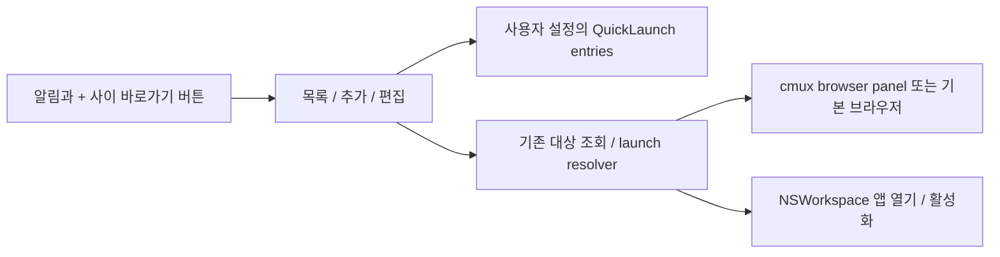

# PRD4 앱·웹 바로가기 설계

> 한 줄 요약: 알림 종과 추가 버튼 사이에 바로가기 목록을 열고 앱·웹·localhost 주소를 등록해 재사용한다. 대상: 사람(설계 검토).

## 1. 범위와 근거

- 요구 원본: 2026-10-29 대화의 PRD4. 특정 앱과 웹(로컬 배포 웹 포함)으로 가는 목록을 알림 종과 + 사이에 추가하며 등록 방식은 아직 미정이다. 별도 PRD 파일은 없다.
- 관련: [ADR-0004](../decisions/0004-local-quick-launch-registry.md). 제안 브랜치: `codex/quick-launch`.
- 2026-10-29 후속 결정: 1차는 클릭 목록, 앱 전체 공통 목록, 현재 workspace의 기존 화면 재사용으로 확정했다. 개별 키보드 조합은 1차에서 제외한다. ‘알림 — 바로가기 — +’ 순서를 유지하며 popover/등록 폼의 세부 UX는 제안이다.
- 관찰 기준: 2026-10-29 HEAD `ef3d1307e116d1c0ba3c6f5ea124a6d28f6c01fe`와 개발 설정 격리가 진행 중인 작업 트리. 실제 UI를 실행하지 않았다.
- 1차 범위: HTTP(S) 웹 주소, localhost 주소, 사용자가 선택한 설치 앱. 이름/아이콘/순서/열 위치를 저장한다.
- 비목표: shell 명령 launcher, 개발 서버 자동 실행/종료, URL 상태 polling, 사용자 계정 간 동기화, 앱 로그인 자동화.

### 현재 구현 근거

- [ContentView](../../../Sources/ContentView.swift)와 [MinimalModeSidebarControls](../../../Sources/Update/MinimalModeSidebarControls.swift)에 titlebar/fullscreen/minimal mode 제어가 있다. 버튼 하나를 넣어도 모드별 배치·hit area를 함께 확인해야 한다.
- [JSONConfigStore](../../../Packages/macOS/CmuxSettings/Sources/CmuxSettings/Stores/JSONConfigStore.swift)는 async actor 기반의 설정 읽기/쓰기와 atomic publish 경로를 제공한다.
- [CmuxConfigLocation](../../../Packages/macOS/CmuxSettings/Sources/CmuxSettings/Stores/CmuxConfigLocation.swift)은 관찰 당시 진행 중인 변경에서 bundle identity별 개발 경로를 계산한다. 현재 내용을 이미 릴리스된 보장으로 간주하지 않는다.
- [ShortcutAction](../../../Packages/macOS/CmuxSettings/Sources/CmuxSettings/Values/ShortcutAction.swift)와 [KeyboardShortcutSettings](../../../Sources/KeyboardShortcutSettings.swift)가 기존 단축키 체계다. 이번 목록을 별도 전역 key event hook으로 구현하지 않는다.

## 2. 논리 구조



| 구성요소 제안 | 소유 경로 | 입력 → 출력 |
|---|---|---|
| QuickLaunchButton/Popover | `Sources/`와 기존 titlebar controls | 클릭 → 목록·등록 폼 |
| QuickLaunchStore | `CmuxSettings`의 typed setting | entry mutation → 검증된 JSON 저장 |
| QuickLaunchResolver | `Sources/` | entry ID + 호출 workspace → 대상 조회/열기 |
| AppTargetResolver | `Sources/` | 저장한 app identity → 실제 설치 앱 |

명칭과 설정 schema는 신규 제안이다. 하나의 resolver를 클릭·메뉴·향후 단축키가 공유하고, 레이아웃마다 동작을 복사하지 않는다.

### 저장 모델 제안

사용자 설정의 신규 `quickLaunch` namespace에 `version: 1`, `entries: []`를 저장한다. 프로젝트별 `.cmux` 설정 자동 병합은 1차 범위에서 제외한다.

```json
{
  "quickLaunch": {
    "version": 1,
    "entries": [
      {
        "id": "example-local-web",
        "name": "로컬 웹",
        "target": { "kind": "web", "url": "http://localhost:3000" },
        "openMode": "in-app",
        "reusePolicy": "focus-or-open",
        "icon": { "kind": "system", "name": "globe" }
      }
    ]
  }
}
```

예시 ID는 설명용이며 실제 ID는 생성한 UUID를 쓴다. 배열 순서가 표시 순서다. 앱의 `target`은 `kind: app`, `bundleIdentifier`, 사용자가 선택한 app URL/bookmark 참조를 가지며 웹 URL과 구분한다. 웹 openMode는 `in-app | system-browser`, 앱은 native 실행이다. icon은 기본 system/app icon을 우선하고 favicon은 실패해도 항목을 사용할 수 있어야 한다.

현재 workspace의 기존 화면 재사용은 사용자 확정이다. schema 표현 제안은 `focus-or-open`이며 `always-open` 옵션은 1차에서 제외한다. URL 비교에서 query/path를 임의 제거해 서로 다른 페이지를 같은 것으로 합치지 않는다.

## 3. 데이터·요청 흐름

### 등록·편집

1. 버튼을 누르면 저장 목록과 마지막 행 ‘바로가기 추가’를 표시한다. 비어 있으면 등록 동작을 설명한다.
2. 웹은 이름·URL·열 위치를 입력한다. ‘현재 페이지 등록’은 현재 URL을 편집 가능한 폼에 채울 뿐 저장을 자동 완료하지 않는다.
3. 앱은 파일/앱 선택기로 설치된 `.app`을 고르고 실제 bundle identity를 읽는다. 임의 shell command 문자열을 앱 경로로 저장하지 않는다.
4. 저장 전 schema와 URL/app target을 검사하고 기존 user config의 해당 namespace만 변경한다. 오류가 나면 이전 목록과 입력 중 초안을 유지한다.
5. 항목 우클릭/편집 메뉴로 이름·대상·순서를 바꾸고 삭제한다. 삭제는 바로가기 항목만 제거하며 이미 실행된 앱/웹을 닫지 않는다.

### 실행과 기존 화면 재사용

- in-app 웹은 같은 workspace/profile에서 해당 entry와 연결된 live panel을 우선 찾고, 없으면 대상 URL과 일치하는 기존 panel을 찾는다. 수동으로 미리 열어둔 웹도 재사용 대상이다. 후보가 여러 개면 최근 사용한 일치 panel을 고르는 안을 제안한다. 일치 대상이 없을 때만 하나 만든다. 다른 workspace/profile의 페이지를 가져오지 않는다.
- 실행 중 같은 항목을 반복 클릭하면 하나의 in-flight open으로 합친다. panel 생성 후 종료됐으면 다음 클릭에서 다시 연다.
- 등록된 panel이 이후 다른 URL로 이동한 경우, 사용자가 보던 페이지를 강제로 덮어쓰지 않는다. 더 이상 entry target을 대표하지 않는 것으로 처리하고 새 panel을 여는 안을 제안한다. 이때 entry의 현재 binding은 새 panel로 갱신한다.
- system-browser 모드는 OS의 기본 브라우저로 URL을 전달한다. 외부 브라우저 탭 재사용 여부는 OS/브라우저가 결정하며 cmux가 보장하지 않는다.
- 앱은 bundle identity와 선택 경로를 확인해 실행 중 인스턴스를 활성화하거나 OS를 통해 연다. 앱이 이동/삭제됐으면 재선택할 수 있는 실패 상태를 표시하고 다른 앱을 임의 실행하지 않는다.
- localhost 페이지가 응답하지 않으면 기존 browser 오류/재시도 UI를 사용한다. 등록 성공이나 launch 요청 성공을 서버 정상 동작으로 표시하지 않는다. 서버를 실행하는 명령은 보내지 않는다.

### 저장 일관성과 복원

기존 JSONConfigStore의 actor/협력적 writer lock/atomic publication 경로를 재사용한다. UI가 읽은 전체 config를 그대로 덮어쓰지 않고 최신 설정에 해당 entry mutation을 적용한다. 다른 window의 변경은 observe 경로로 반영한다.

중복 ID, 잘못된 target, 모르는 schema version의 처리 방침을 검사한다. 알 수 없는 새 버전은 쓰기를 멈추고 원본을 보존하며 진단한다. 구버전 앱이 모르는 namespace를 유지하는지 round-trip 검증한다. 손상된 항목을 조용히 삭제하거나 새 기본값으로 덮어쓰지 않는다. 관계형 DB·ERD는 해당 없음: 기존 JSON 설정과 transient panel binding을 사용한다.

## 4. 실행·배포 환경 (AWS 사용 또는 비교 요청 시 AWS 뷰 포함)

- 로컬 macOS 앱, 기존 browser panel 생성과 NSWorkspace API를 사용한다. 별도 서버·AWS 자원·계정은 없다.
- [포크 개발 가이드](../../jmin-development.md)의 resolver로 설정 위치를 구한다. `~/.config/cmux/cmux.json`을 새 코드에 하드코딩하지 않는다. 개발 경로 격리의 미커밋 변경은 통합 기준이 확정될 때 다시 검증한다.
- 정상/minimal/fullscreen 및 sidebar 숨김 상태에서 같은 목록과 행동을 제공한다. 폭이 부족하면 기존 control overflow 정책에 맞추되 알림/+의 hit area를 침범하지 않는다.
- 배포는 앱 변경이다. 출시·지원 기간·최대 항목 수는 미정. feature OFF는 버튼을 숨기며 저장한 entries는 남겨 재활성화할 수 있게 한다.
- 현재 `jmin` 고정 태그로 여러 브랜치를 동시에 실행하지 않는다. 고유 bundle/socket/config 준비는 각 feature 실행 전 공통 환경 작업이다.

## 5. 보안·관측·운영

웹 URL은 1차에 `http`/`https`를 지원한다. `javascript:`, 임의 shell/deep-link 실행, URL 내 credential 자동 채움은 지원하지 않는다. localhost의 HTTP는 명시적으로 허용한다. 현재 페이지의 query가 민감할 수 있으므로 등록 폼에서 사용자가 확인·편집할 수 있게 하고, URL 전체를 진단 로그에 남기지 않는다.

설정 쓰기는 사용자 등록/편집/삭제 동작에서만 일어난다. 앱 열기는 사용자가 등록한 검증된 target만 사용하며 shell 문자열 보간을 사용하지 않는다. 로컬 주소는 사용자의 Mac 기준이며 remote workspace의 localhost로 자동 치환하지 않는다.

진단은 entry ID, target kind, launch/focus 결과, 설정 오류 코드만 기록한다. 제품 흐름에 별도의 승인 절차를 추가하지 않고 잘못된 입력은 해당 폼에서 설명한다. 키보드 탐색·접근성 label·focus 복귀는 popover의 기본 요구다.

## 6. 검증 계획과 미확인

| 검증 | 통과 조건 | 실패 신호 |
|---|---|---|
| 추가/편집/삭제/순서/재시작 | 동일 목록 복원, 다른 설정 보존 | 설정 소실·순서 변경·실행 앱 종료 |
| 두 window의 설정 수정 | 서로 다른 entry 변경 보존 | 이전 snapshot으로 전체 덮어쓰기 |
| 반복 클릭 | 같은 workspace에서 한 panel 재사용 | 연속 클릭마다 panel 증가 |
| 다른 workspace/profile | 지정 범위에서만 재사용 | 다른 작업의 페이지 강제 이동 |
| URL/query·앱 identity | 잘못된 값 차단, 정확한 target 열기 | 다른 페이지/앱 실행 |
| localhost down/앱 삭제 | 오류와 재시도/수정 경로 | 서버 자동 시작 또는 성공 오표시 |
| 개발/설치 앱 병행 | 개발 설정에만 바로가기 저장 | 설치 앱 설정 변경 |
| 모드·폭·접근성 | 알림과 + 사이의 조작 가능 위치 | 겹침, 클릭 영역 충돌, focus 소실 |

현재 검증은 코드 읽기와 문서 검사다. 앱 실행·스토어 mutation·OS launch는 수행하지 않았다. 저장 schema·명령 palette·shortcut metadata를 구현할 때는 기존 schema 및 localization 검증에 포함한다.

확정: 클릭 목록, 앱 전체 공통, 현재 workspace의 기존 화면 재사용. 미결: 등록 UI 세부사항, 웹의 기본 열 위치와 외부 브라우저 옵션 범위, 아이콘 선택, 일치 panel이 여러 개일 때의 우선순위. 재사용을 기본값으로 하며 같은 항목의 반복 클릭으로 새 panel을 계속 만들지 않는다.

## 관련

- [ADR-0004](../decisions/0004-local-quick-launch-registry.md)
- [기능 문서 색인](../INDEX.md)
- [포크 개발 가이드](../../jmin-development.md)

## 2026-10-29 구현 기록

사용자의 병렬 구현 요청에 따라 `codex/quick-launch`에서 구현했다. [구현·검증 기록](../implementation/quick-launch-handoff.md)에 선택한 UI, 저장 schema, 재사용 우선순위, 로컬 workspace 범위 및 미완료 네이티브 검증을 기록했다. 위 초안의 `icon` 객체는 1차 구현에서 허용된 SF Symbol 이름의 `symbol` 필드로 구체화했다. 앱 대상은 URL과 bundleIdentifier 및 선택적 bookmark를 저장한다.
